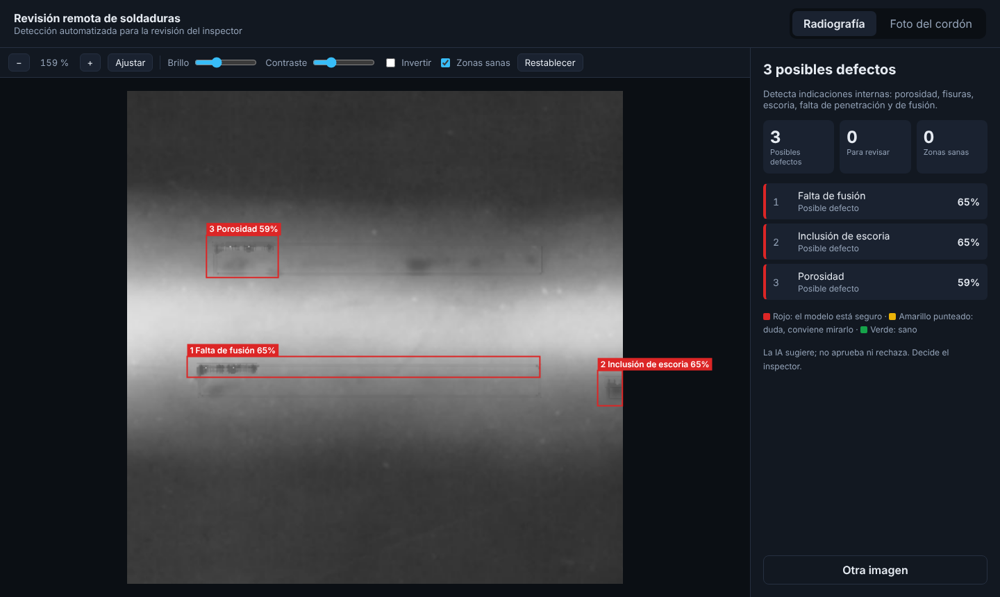

# Revisión remota de soldaduras con IA

**Demo:** https://scheffan.github.io/weld-inspection-ai/

Detección automatizada para la revisión del inspector. Subís una radiografía de soldadura o una foto del cordón y la app marca dónde puede haber un defecto, dónde conviene mirar y dónde está bien. **La IA prioriza; el inspector decide.**

Todo corre en tu navegador: la imagen no se sube a ningún servidor.

## Cómo funciona

1. **Portero.** Un clasificador chico revisa qué imagen subiste: radiografía de soldadura, foto de cordón u otra cosa. Si no coincide con la pestaña elegida, avisa antes de analizar.
2. **Detector.** Cada tipo de imagen tiene su propio modelo (RT-DETR). Las placas alargadas se analizan por partes superpuestas, para no perder defectos chicos.
3. **Tres niveles.** Rojo: el modelo está seguro. Amarillo punteado: duda, conviene mirarlo. Verde: zona sana.
4. **Visor.** Zoom, arrastre, brillo, contraste e invertir, como en un negatoscopio.

## Resultados medidos (imágenes que los modelos nunca vieron)

| Modelo | Resultado |
|---|---|
| Radiografías | Marca el **95,6 %** de las placas con defecto · mAP@50 0,648 · 1 de cada 10 zonas sanas con falsa alarma |
| Fotos de cordones | Marca el **97,7 %** de las fotos con defecto · mAP@50 0,549 · más falsas alarmas (38 % de fotos sanas) |
| Portero | **99,7 %** de acierto · ninguna radiografía de tórax confundida con una de soldadura (0 de 216) |

Los umbrales se eligieron para no perder defectos, a costa de algunas falsas alarmas que el inspector descarta.

## Límites

- Es una demo de portfolio, no un sistema certificado ni un reemplazo del inspector.
- Se entrenó con datos públicos; un uso real requiere reentrenar con radiografías propias, bajo la norma que corresponda (API 1104, ISO 5817, etc.).
- Una foto solo muestra la superficie: los defectos internos se ven en radiografía.

## Créditos

- **Datos de entrenamiento:** radiografías "weld" (kunkun) y "weld data" (Vayun Goel) y fotos "Welding_Defects", en Roboflow Universe, bajo CC BY 4.0; fotos "welding defects detection" (dominio público).
- **Portero:** además, Imagenette (Jeremy Howard / fast.ai, Apache 2.0) y "Chest X-Ray Images (Pneumonia)" (Kermany et al., CC BY 4.0).
- **Modelos base:** RT-DETR R18 (PekingU, Apache 2.0) y MobileNetV3-Small (torchvision, BSD), ajustados para este proyecto.
- **Motor en el navegador:** ONNX Runtime Web (MIT).

---

Proyecto de **Esteban Mendez** · Data Analyst y QA · [portf.maitweb.com](https://portf.maitweb.com)
