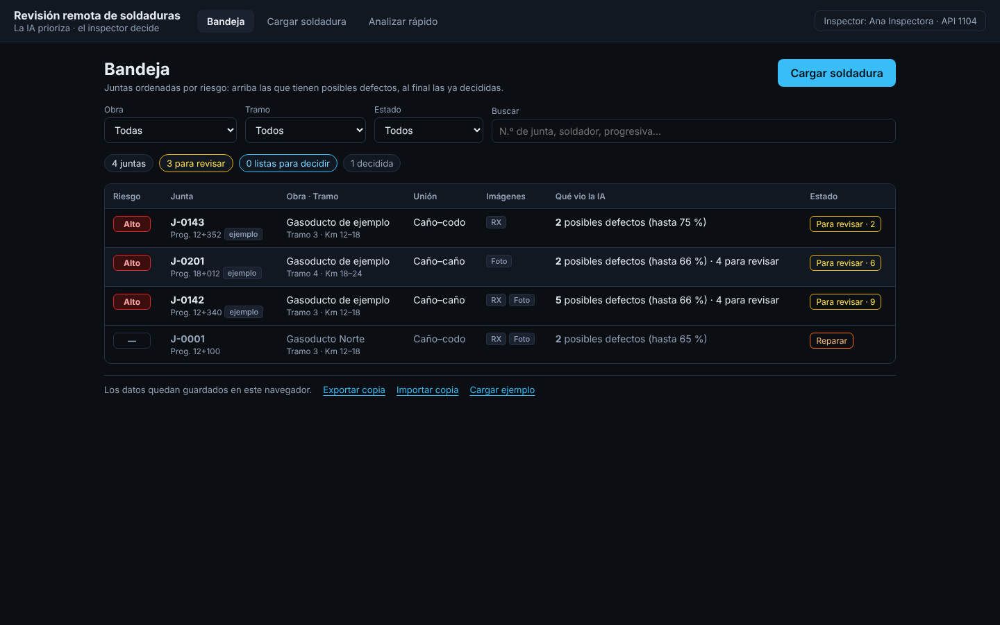
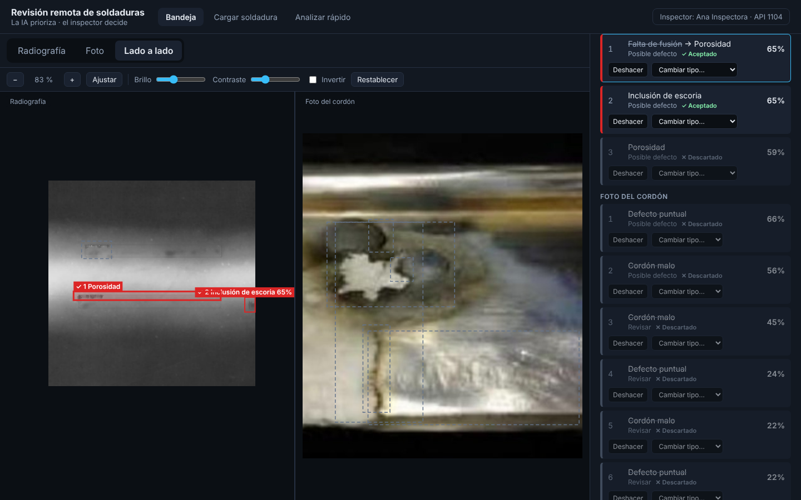
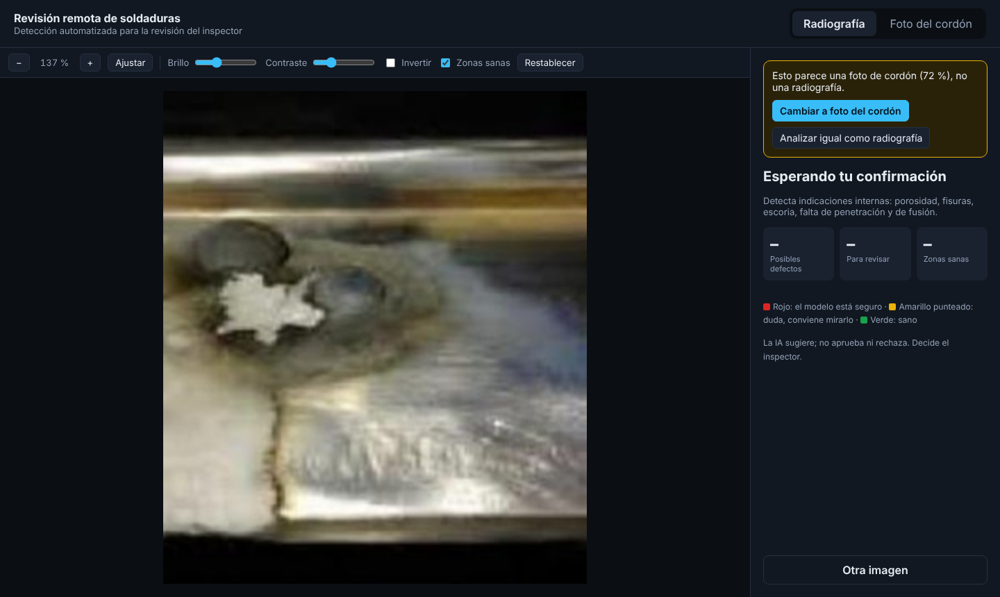

# Revisión remota de soldaduras con IA

**Demo:** https://scheffan.github.io/weld-inspection-ai/

Detección automatizada para la revisión remota de soldaduras de ductos. El técnico carga cada junta con su radiografía y/o foto del cordón; la IA marca dónde puede haber un defecto y ordena la bandeja por riesgo; el inspector revisa cada hallazgo y decide. **La IA prioriza; el inspector decide.**

Todo corre en tu navegador: las imágenes y los datos no se suben a ningún servidor. Para probar sin imágenes propias, tocá **"Cargar ejemplo"** en la bandeja.

## Flujo del inspector

1. **Cargar soldadura:** obra, tramo, N.º de junta, progresiva, tipo de unión, material, diámetro, espesor, proceso y soldador, más la radiografía y/o la foto. Al elegir cada imagen, el portero avisa si no corresponde (por ejemplo, una foto puesta donde va la radiografía).
2. **Bandeja:** juntas ordenadas por riesgo, con filtros por obra, tramo y estado.
3. **Revisión:** radiografía, foto o las dos lado a lado. Cada hallazgo se acepta, se descarta o se le cambia el tipo.
4. **Decisión:** aprobada, reparar o rechazada. Queda bloqueada hasta revisar todos los hallazgos y registra inspector, norma y fecha.
5. **Informe y auditoría:** informe listo para guardar como PDF, e historial de quién hizo qué y cuándo.

## Cómo funciona la IA

1. **Portero.** Un clasificador chico revisa qué imagen subiste: radiografía de soldadura, foto de cordón u otra cosa. Si no coincide con la pestaña elegida, avisa antes de analizar.
2. **Detector.** Cada tipo de imagen tiene su propio modelo (RT-DETR). Las placas alargadas se analizan por partes superpuestas, para no perder defectos chicos.
3. **Tres niveles.** Rojo: el modelo está seguro. Amarillo punteado: duda, conviene mirarlo. Verde: zona sana.
4. **Visor.** Zoom, arrastre, brillo, contraste e invertir, como en un negatoscopio.

## Resultados medidos (imágenes que los modelos nunca vieron)

| Modelo | Resultado |
|---|---|
| Radiografías | Marca el **95,6 %** de las placas con defecto · mAP@50 0,648 · 1 de cada 10 zonas sanas con falsa alarma |
| Fotos de cordones | Marca el **97,7 %** de las fotos con defecto · mAP@50 0,549 · más falsas alarmas (38 % de fotos sanas) |
| Portero | **99,7 %** de acierto · ninguna radiografía de tórax confundida con una de soldadura (0 de 216) |

Los umbrales se eligieron para no perder defectos, a costa de algunas falsas alarmas que el inspector descarta.

## Límites

- Es una demo de portfolio, no un sistema certificado ni un reemplazo del inspector.
- Los datos quedan guardados solo en el navegador de quien la usa (se puede exportar una copia); no hay cuentas ni trabajo en equipo.
- Se entrenó con datos públicos; un uso real requiere reentrenar con radiografías propias, bajo la norma que corresponda (API 1104, ISO 5817, etc.).
- Una foto solo muestra la superficie: los defectos internos se ven en radiografía.

## Créditos

- **Datos de entrenamiento:** radiografías "weld" (kunkun) y "weld data" (Vayun Goel) y fotos "Welding_Defects", en Roboflow Universe, bajo CC BY 4.0; fotos "welding defects detection" (dominio público).
- **Portero:** además, Imagenette (Jeremy Howard / fast.ai, Apache 2.0) y "Chest X-Ray Images (Pneumonia)" (Kermany et al., CC BY 4.0).
- **Imágenes de la obra de ejemplo:** de los mismos datasets de Roboflow.
- **Modelos base:** RT-DETR R18 (PekingU, Apache 2.0) y MobileNetV3-Small (torchvision, BSD), ajustados para este proyecto.
- **Motor en el navegador:** ONNX Runtime Web (MIT).

---

Proyecto de **Esteban Mendez** · Data Analyst y QA · [portf.maitweb.com](https://portf.maitweb.com)
